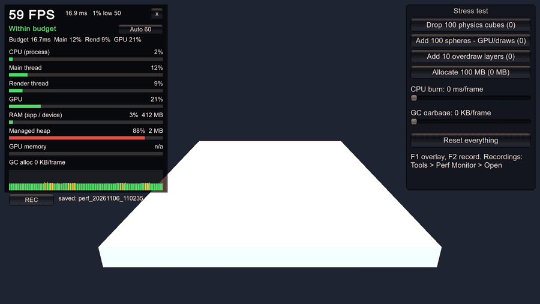
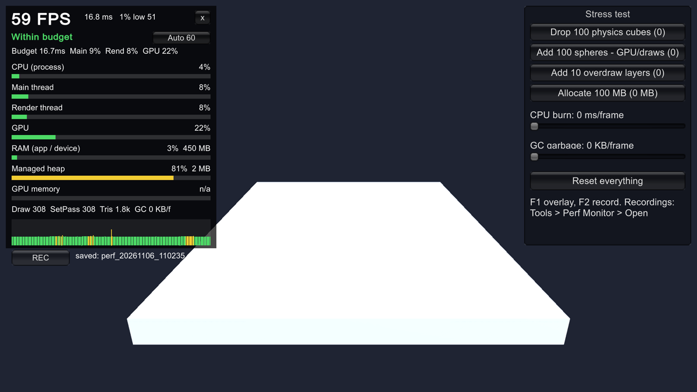
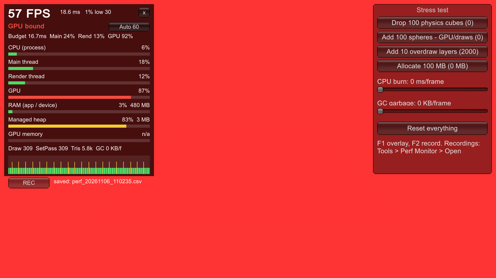
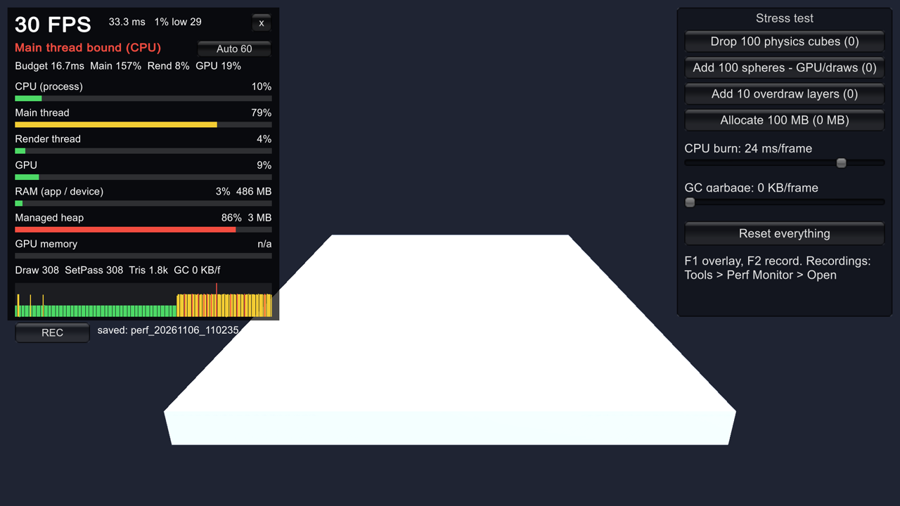

# Unity Perf Monitor

A small in-game performance overlay for Unity, in the spirit of GameBench. It shows FPS, CPU, GPU and memory load while the game runs, names what is holding the frame back, and can record a session to CSV.

This is the **showcase edition**. A full version with build comparison for CI, live engine streaming to a phone profiler and live tuning exists privately; see [Full version](#full-version).



| Within budget | GPU bound | Main thread bound |
|---|---|---|
|  |  |  |

Captured from the demo as a release macOS player on a MacBook Pro (M1 Pro), 1920x1080, 60 FPS target.

- `PerfMonitor/` - the package (Unity 2021.3+ and Unity 6, no dependencies)
- `PerfMonitorDemo/` - a Unity 6 demo project with a stress-test panel

## Try the demo
1. Open `PerfMonitorDemo` in Unity 6000.3 (or newer).
2. Open `Assets/Scenes/Demo.unity` and press Play.
3. Use the buttons on the right to load the CPU, GPU, memory and GC, and watch the overlay react.

## Use it in your own project
In Unity open **Window > Package Manager > + > Add package from git URL** and paste:

```
https://github.com/abhinandand91-debug/unity-perf-monitor.git?path=/PerfMonitor
```

The overlay starts itself in the Editor and Development builds. Release builds: call `PerfMonitor.Overlay.PerfOverlay.Create()`.

Controls: **F1** show/hide, **F2** start/stop recording (or use the on-screen buttons). For GPU numbers turn on **Tools > Perf Monitor > Enable Frame Timing Stats** (builds do this automatically).

## Frame budget verdict
The overlay compares the main thread, render thread and GPU against the frame budget of your target FPS (the **Target** button cycles Auto / 30 / 60 / 90 / 120) and names the bottleneck: `GPU bound`, `Main thread bound (CPU)`, `Render thread bound`, `Memory pressure`, `Over budget, waiting (vsync or stall)` or `Within budget`. The line under it shows each unit as a percent of the budget, which can go above 100%.

## Full version
The full Perf Monitor is kept private. On top of this edition it adds:

- **Compare two builds:** an editor window and a CI command that compare two recordings and fail a build that got slower
- **Engine streaming to PerfScope:** draw calls, garbage, and where each slow frame's time went, sent live to PerfScope, a desktop tool that watches a phone over USB and explains every FPS drop
- **Live tuning:** PerfScope changes the game's settings while it runs and measures what each one costs on the real phone, then ranks the fixes
- **Presets per phone model:** the settings that worked on a phone, applied automatically on that model, in release builds too

For access or a demo, open an issue or contact me on [GitHub](https://github.com/abhinandand91-debug).

## What is measured
| Metric | Source |
|---|---|
| CPU (process) | OS process CPU time / (wall time x cores) |
| Main thread | Player loop timer: work from EarlyUpdate to the end of PostLateUpdate, so waiting for vsync or the target frame rate is not counted |
| Render thread, GPU | FrameTimingManager busy time / frame time (render thread needs 2022.2+) |
| RAM | ProfilerRecorder "System Used Memory" / device RAM |
| Managed heap | GC used / GC reserved |
| GPU memory | "Gfx Used Memory" / graphics memory size |
| Draw calls, SetPass, triangles | ProfilerRecorder render counters |

A metric shows `n/a` when the platform does not provide it (for example GPU time on some devices, or process CPU on iOS and WebGL).

## Code layout
```
PerfMonitor/Runtime
  Core/        PerfSample, IMetricProvider, MetricsCollector, FrameBudget, BudgetAnalyzer
  Providers/   FrameTiming, ProcessCpu, Memory, RenderStats (one IMetricProvider each)
  Recording/   PerfRecorder, CsvWriter, SessionSummary
  Overlay/     PerfOverlay (entry point), OverlayDrawer, FrameHistory, SampleSmoother
PerfMonitor/Editor   menu items and build hook
```
To add a metric, write a new `IMetricProvider` and add it to `MetricsCollector`.

## License
MIT

## Limits
It measures from inside the game. It cannot see other apps, true hardware GPU utilisation, thermals or power draw; use Xcode Instruments or Android Perfetto for those.

GC allocation per frame comes from a profiler counter that Unity only fills in the Editor and Development builds, so it reads 0 in release builds.
